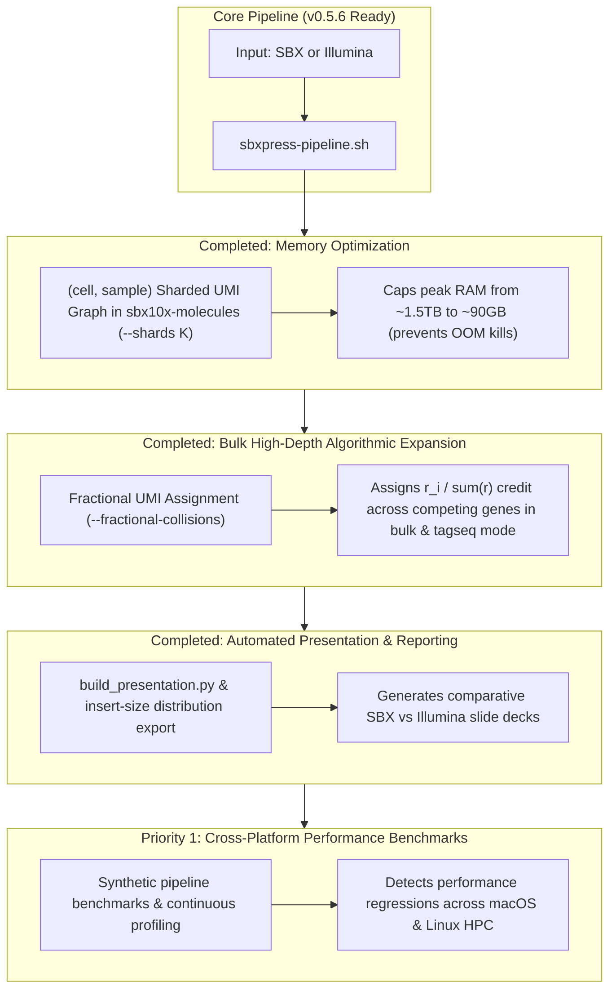

# `sbxpress` Master Roadmap & Execution Plan

> **Status**: Updated as of v0.5.9 (2026-10-07). Consolidates all historic plans (`docs/archive/FLEX_SUPPORT_PLAN.md`, `docs/archive/GENE_COLLISION_RESOLUTION_PLAN.md`, `docs/archive/OVERLAP_PLAN.md`, `docs/archive/PRESENTATION_PLAN.md`, `PIPELINE_NOTES.md`) into a single master tracking document.

---

## 1. Completed Milestone Matrix (v0.3.3 → v0.5.6)

| Feature / Milestone | Module / Binary | Version | Status |
| :--- | :--- | :--- | :--- |
| **Standard 10x 3′ GEX Pipeline** | `extract`, `minimap2`, `annotate`, `molecules`, `matrix`, `cells` | `v0.3.4` | 🟢 **Completed** |
| **Illumina PE Overlap & YC Tagging** | `sbxpress illumina --overlap`, `sbx10x::yc` | `v0.3.7` | 🟢 **Completed** |
| **CAT Tagseq Molecule & Cell Calling** | `molecules --tagseq`, `cells --tagseq-barcodes` | `v0.3.8` | 🟢 **Completed** |
| **10x Flex Probe Demux & Composite Barcoding** | `sbxpress probe-demux`, `matrix --probe-barcodes` | `v0.4.0` | 🟢 **Completed** |
| **CRISPR Feature Capture & GMM Thresholding** | `feature_capture.rs`, `sbxpress protospacer-call` | `v0.5.0` | 🟢 **Completed** |
| **10x Flex Probe-Set Alignment Engine** | `sbxpress probeset-align` (`src/probe_set.rs`) | `v0.5.0` | 🟢 **Completed** |
| **Illumina + Flex / Tagseq Integration Tests** | `tests/illumina_modes_integration.rs` | `v0.5.2` | 🟢 **Completed** |
| **Native Multi-Threading in `probeset-align`** | `sbxpress probeset-align --threads N` (Rayon pool) | `v0.5.3` | 🟢 **Completed** |
| **Unified Pipeline Driver Script** | `scripts/sbxpress-pipeline.sh` (2 input × 3 analysis modes) | `v0.5.4` | 🟢 **Completed** |
| **Hot-Path Microbenchmark Suite Expansion** | `benches/pipeline_hot_paths.rs` (`ProbeMatcher`) | `v0.5.5` | 🟢 **Completed** |
| **Master Roadmap & Plan Consolidation** | `FUTURE_ROADMAP.md` & historic plan header consolidation | `v0.5.6` | 🟢 **Completed** |
| **Sharded Peak Memory Bounding** | `sbx10x-molecules --shards K` | `v0.5.6` | 🟢 **Completed** |
| **Fractional UMI Collision Resolution** | `molecules --fractional-collisions` & `cr_bam_to_mtx` `ZW:f` | `v0.5.6` | 🟢 **Completed** |
| **Automated Presentation & Reporting** | `scripts/build_presentation.py` & insert-size export | `v0.5.6` | 🟢 **Completed** |

---

## 2. Open Technical Enhancements & Future Roadmap

---

### Priority 1 (Completed v0.5.6): Bounding Peak Memory in `sbx10x-molecules`

- **Status**: 🟢 **Completed in v0.5.6**.
- **Implementation**: `--shards K` partitions evidence by `hash(cell, sample) % K`, sequentially executing collate $\rightarrow$ UMI correction $\rightarrow$ gene collision resolution $\rightarrow$ BAM writing per shard, bounding peak RSS by $\text{total} / K$.

---

### Priority 2 (Completed v0.5.6): Fractional UMI Collision Assignment for High-Depth Bulk & Tagseq Modes

- **Status**: 🟢 **Completed in v0.5.6; reworked after review** (the 0.5.6–0.5.8 implementation crashed on real BAMs and wrote no representatives — see CHANGELOG 0.5.9).
- **Implementation**:
  1. Added `--fractional-collisions` to `sbx10x-molecules`. Was the `--tagseq` default in 0.5.6–0.5.9; opt-in since, after review showed it undercounts when collisions are chance events (Shared is the default; see also `--position-aware-umis` and `scripts/compare_tagseq_modes.sh`).
  2. For colliding genes $g_1 \dots g_k$ with read counts $r_1 \dots r_k$, assigns proportional credit $w_i = r_i / \sum r$, tagging records with `XW:A:F` and floating-point weight tag `ZW:f:<weight>` (`ZG` stays `annotate`'s gene call). `sbxpress cells` reads the resulting `f32` matrices without truncation.
  3. Updated `cr_bam_to_mtx` matrix materialization to parse `ZW:f` weight tags and output `real` Matrix Market MTX (`%%MatrixMarket matrix coordinate real general`) and `f32` CSC HDF5 matrices (`raw_feature_bc_matrix.h5`).

---

### Priority 3 (Completed v0.5.6): Automated Slide Deck & Insert-Size Reporting

- **Status**: 🟢 **Completed in v0.5.6**.
- **Implementation**:
  1. Added `--export-insert-sizes` and `--report-dir` options to `scripts/build_presentation.py`.
  2. Ingests Illumina, molecules, and cell calling metrics JSON files, exporting cDNA insert-length distribution TSVs and dynamically generating 10-slide PowerPoint presentations (`.pptx`).

---

### Priority 4: Cross-Platform Performance Benchmarks & Continuous Profiling

- **Context** ([`PROFILING.md`](PROFILING.md)):
  Criterion microbenchmarks in [`benches/pipeline_hot_paths.rs`](benches/pipeline_hot_paths.rs) run locally using synthetic data without external network dependencies (~740 ns/read, ~1.35M reads/sec/core for `ProbeMatcher::locate`). Cross-platform performance validation across local development (macOS) and production high-performance computing (Linux 512-core / 1.5TB RAM) requires continuous profiling tracking.
- **Proposed Architecture**:
  1. Add synthetic end-to-end throughput benchmarks to `benches/pipeline_hot_paths.rs` simulating whole pipeline stages.
  2. Maintain automated profiling scripts wrapping `cargo bench` and CPU/memory instrumentation (`samply`, `perf`).
- **Expected Impact**: Catches performance regressions in hot-path sequence parsing and alignment prior to deployment on production HPC clusters.

### Priority 5: Evaluate TSO Trimming (follow-up raised 2026-10-13)

- **Context**: No path trims the template-switch oligo by default.
  `sbxpress extract --trim-tso` is off ("enabling it changes emitted cDNA,
  so measure the delta before adopting"). `sbxpress illumina --trim-tso`
  acts only on merged pairs (`--overlap`), and `sbxpress-pipeline.sh` passes
  neither flag, so unmerged Illumina R2 is never TSO-trimmed. Poly-A/T is
  already handled: `extract` keeps only the cDNA between the dT run and the
  adapter, and `illumina` trims R2 poly-A read-through by default (90%-A
  tail, 0.6.2). minimap2 soft-clips an untrimmed TSO (~30 nt, non-genomic,
  ending GGG), so the expected cost is a shorter aligned span (lower MAPQ or
  an unmapped short read) rather than misplacement. The TSO is present only
  on fragments that reach the transcript 5' end, so it is likely more common
  in short fragments and in the SBX 5p library.
- **Proposed Work**:
  1. Run `sbxpress audit` on the CAT02 matched-depth annotated BAMs
     (`sbxpress_validation/cat02_matched_depth`: Illumina, SBX 3p, SBX 5p),
     which reports TSO in 5'/3' soft clips as a share of mapped reads.
  2. On a subset of each library, compare with and without TSO trimming
     (`extract --trim-tso`; for Illumina, unmerged-R2 TSO trimming, which
     needs a code change) on eligible reads, molecules, cells and per-gene
     counts.
  3. Adopt as a default only if the gain is measurable and nothing is lost.
- **Expected Impact**: Decides whether TSO trimming should be on by default
  for each input mode, with data behind it.
