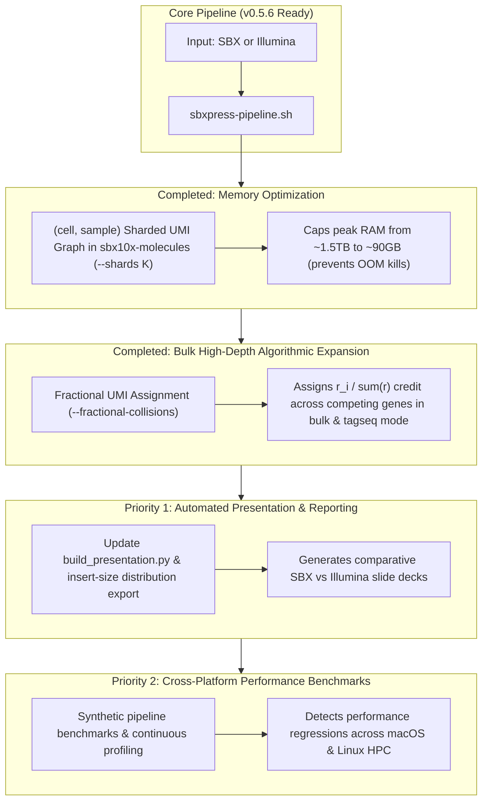

# `sbxpress` Master Roadmap & Execution Plan

> **Status**: Updated as of v0.5.6 (2026-10-06). Consolidates all historic plans (`FLEX_SUPPORT_PLAN.md`, `GENE_COLLISION_RESOLUTION_PLAN.md`, `OVERLAP_PLAN.md`, `PIPELINE_NOTES.md`, `PRESENTATION_PLAN.md`) into a single master tracking document.

---

## 1. Completed Milestone Matrix (v0.3.3 → v0.5.6)

| Feature / Milestone | Module / Binary | Version | Status |
| :--- | :--- | :--- | :--- |
| **Standard 10x 3′ GEX Pipeline** | `extract`, `minimap2`, `annotate`, `molecules`, `matrix`, `cells` | `v0.3.4` | 🟢 **Completed** |
| **Illumina PE Overlap & YC Tagging** | `sbxpress illumina --overlap`, `sbx10x::yc` | `v0.3.7` | 🟢 **Completed** |
| **CAT Tagseq Molecule & Cell Calling** | `molecules --tagseq`, `cells --tagseq-barcodes` | `v0.3.8` | 🟢 **Completed** |
| **10x Flex Probe Demux & Composite Barcoding** | `sbxpress probe-demux`, `matrix --probe-barcodes` | `v0.4.0` | 🟢 **Completed** |
| **CRISPR Feature Capture & GMM Thresholding** | `feature_capture.rs`, `sbxpress protospacer-call` | `v0.5.0` | 🟢 **Completed** |
| **10x Flex Probe-Set Alignment Engine** | `sbxpress probeset-align` (`src/probe_set.rs`) | `v0.5.0` | 🟢 **Completed** |
| **Illumina + Flex / Tagseq Integration Tests** | `tests/illumina_modes_integration.rs` | `v0.5.2` | 🟢 **Completed** |
| **Native Multi-Threading in `probeset-align`** | `sbxpress probeset-align --threads N` (Rayon pool) | `v0.5.3` | 🟢 **Completed** |
| **Unified Pipeline Driver Script** | `scripts/sbxpress-pipeline.sh` (2 input × 3 analysis modes) | `v0.5.4` | 🟢 **Completed** |
| **Hot-Path Microbenchmark Suite Expansion** | `benches/pipeline_hot_paths.rs` (`ProbeMatcher`) | `v0.5.5` | 🟢 **Completed** |
| **Master Roadmap & Plan Consolidation** | `FUTURE_ROADMAP.md` & historic plan header consolidation | `v0.5.6` | 🟢 **Completed** |
| **Sharded Peak Memory Bounding** | `sbx10x-molecules --shards K` | `v0.5.6` | 🟢 **Completed** |
| **Fractional UMI Collision Resolution** | `molecules --fractional-collisions` & `cr_bam_to_mtx` `ZW:f` | `v0.5.6` | 🟢 **Completed** |

---

## 2. Open Technical Enhancements & Future Roadmap

---

### Priority 1 (Completed v0.5.6): Bounding Peak Memory in `sbx10x-molecules`

- **Status**: 🟢 **Completed in v0.5.6**.
- **Implementation**: `--shards K` partitions evidence by `hash(cell, sample) % K`, sequentially executing collate $\rightarrow$ UMI correction $\rightarrow$ gene collision resolution $\rightarrow$ BAM writing per shard, bounding peak RSS by $\text{total} / K$.

---

### Priority 2 (Completed v0.5.6): Fractional UMI Collision Assignment for High-Depth Bulk & Tagseq Modes

- **Status**: 🟢 **Completed in v0.5.6**.
- **Implementation**:
  1. Added `--fractional-collisions` and `--no-fractional-collisions` flags to `sbx10x-molecules`. Enabled by default in `--tagseq` mode.
  2. For colliding genes $g_1 \dots g_k$ with read counts $r_1 \dots r_k$, assigns proportional credit $w_i = r_i / \sum r$, tagging records with `ZG:Z:fractional` and floating-point weight tag `ZW:f:<weight>`.
  3. Updated `cr_bam_to_mtx` matrix materialization to parse `ZW:f` weight tags and output `real` Matrix Market MTX (`%%MatrixMarket matrix coordinate real general`) and `f32` CSC HDF5 matrices (`raw_feature_bc_matrix.h5`).

---

### Priority 3: Automated Slide Deck & Insert-Size Reporting

- **Context** ([`OVERLAP_PLAN.md`](OVERLAP_PLAN.md) & [`PRESENTATION_PLAN.md`](PRESENTATION_PLAN.md)):
  `sbxpress illumina --overlap` merges Illumina mates and calculates insert size distributions, but these are not yet automatically ingested into presentation generators.
- **Proposed Architecture**:
  1. Add `--export-insert-sizes` to `sbxpress illumina --overlap` to output a TSV/JSON insert-length histogram.
  2. Update [`scripts/build_presentation.py`](scripts/build_presentation.py) to ingest output metrics from [`scripts/sbxpress-pipeline.sh`](scripts/sbxpress-pipeline.sh).
- **Expected Impact**: Automates comparative SBX vs. Illumina evaluation reports and slide deck generation.

---

### Priority 4: Cross-Platform Performance Benchmarks & Continuous Profiling

- **Context** ([`PROFILING.md`](PROFILING.md)):
  Criterion microbenchmarks in [`benches/pipeline_hot_paths.rs`](benches/pipeline_hot_paths.rs) run locally using synthetic data without external network dependencies (~740 ns/read, ~1.35M reads/sec/core for `ProbeMatcher::locate`). Cross-platform performance validation across local development (macOS) and production high-performance computing (Linux 512-core / 1.5TB RAM) requires continuous profiling tracking.
- **Proposed Architecture**:
  1. Add synthetic end-to-end throughput benchmarks to `benches/pipeline_hot_paths.rs` simulating whole pipeline stages.
  2. Maintain automated profiling scripts wrapping `cargo bench` and CPU/memory instrumentation (`samply`, `perf`).
- **Expected Impact**: Catches performance regressions in hot-path sequence parsing and alignment prior to deployment on production HPC clusters.

