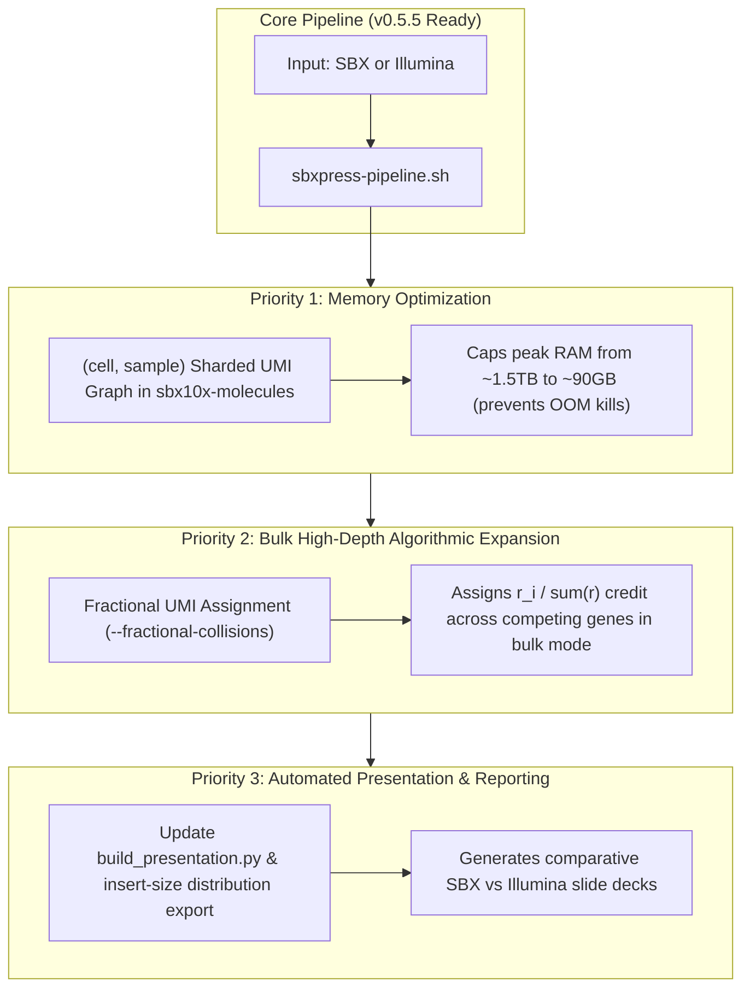

# `sbxpress` Master Roadmap & Execution Plan

> **Status**: Updated as of v0.5.5 (2026-10-06). Consolidates all historic plans (`FLEX_SUPPORT_PLAN.md`, `GENE_COLLISION_RESOLUTION_PLAN.md`, `OVERLAP_PLAN.md`, `PIPELINE_NOTES.md`) into a single master tracking document.

---

## 1. Completed Milestone Matrix (v0.3.3 → v0.5.5)

| Feature / Milestone | Module / Binary | Version | Status |
| :--- | :--- | :--- | :--- |
| **Standard 10x 3′ GEX Pipeline** | `extract`, `minimap2`, `annotate`, `molecules`, `matrix`, `cells` | `v0.3.4` | 🟢 **Completed** |
| **Illumina PE Overlap & YC Tagging** | `sbxpress illumina --overlap`, `sbx10x::yc` | `v0.3.7` | 🟢 **Completed** |
| **CAT Tagseq Molecule & Cell Calling** | `molecules --tagseq`, `cells --tagseq-barcodes` | `v0.3.8` | 🟢 **Completed** |
| **10x Flex Probe Demux & Composite Barcoding** | `sbxpress probe-demux`, `matrix --probe-barcodes` | `v0.4.0` | 🟢 **Completed** |
| **CRISPR Feature Capture & GMM Thresholding** | `feature_capture.rs`, `sbxpress protospacer-call` | `v0.5.0` | 🟢 **Completed** |
| **10x Flex Probe-Set Alignment Engine** | `sbxpress probeset-align` (`src/probe_set.rs`) | `v0.5.0` | 🟢 **Completed** |
| **Illumina + Flex / Tagseq Integration Tests** | `tests/illumina_modes_integration.rs` | `v0.5.2` | 🟢 **Completed** |
| **Native Multi-Threading in `probeset-align`** | `sbxpress probeset-align --threads N` (Rayon pool) | `v0.5.3` | 🟢 **Completed** |
| **Unified Pipeline Driver Script** | `scripts/sbxpress-pipeline.sh` (2 input × 3 analysis modes) | `v0.5.4` | 🟢 **Completed** |
| **Hot-Path Microbenchmark Suite Expansion** | `benches/pipeline_hot_paths.rs` (`ProbeMatcher`) | `v0.5.5` | 🟢 **Completed** |

---

## 2. Open Technical Enhancements & Future Roadmap

---

### Priority 1: Bounding Peak Memory in `sbx10x-molecules`

- **Context** ([`PIPELINE_NOTES.md`](PIPELINE_NOTES.md#L81-L117)):
  At multi-billion read scale, `sbx10x-molecules` evidence collection (`--evidence-workers 64`) can consume up to ~1.49TB RAM, causing Linux kernel OOM kills. Worker-local tables add duplicated overhead on top of global structures (`evidence`, `roots`, `decisions`).
- **Proposed Architecture**:
  1. Both UMI grouping (`(cell, sample, gene)`) and cross-gene collision resolution (`(cell, sample, umi)`) share `(cell, sample)` as their outer key.
  2. Implement `--cell-sample-shards K` in [`src/bin/sbx10x-molecules.rs`](src/bin/sbx10x-molecules.rs). Partition input records into $K$ streams based on `hash(cell, sample)`.
  3. Process each shard sequentially through grouping $\rightarrow$ UMI correction $\rightarrow$ collision resolution $\rightarrow$ BAM writing, freeing each shard's memory before starting the next.
- **Expected Impact**: Reduces peak memory by $K$-fold (e.g. $K=16$ reduces a 1.5TB memory footprint down to ~90GB).

---

### Priority 2: Fractional UMI Collision Assignment for High-Depth Bulk Mode

- **Context** ([`GENE_COLLISION_RESOLUTION_PLAN.md`](GENE_COLLISION_RESOLUTION_PLAN.md)):
  On ultra-deep bulk sequencing runs (e.g. DZEC03 with 2–25M reads per barcode), UMI space ($16.8\text{M}$) is 2.1x oversubscribed. Winner-take-all collision resolution currently discards all "lost" molecules or ties (accounting for ~81% of observed `(cell, UMI)` pairs).
- **Proposed Architecture**:
  1. Add `--fractional-collisions` flag to [`src/bin/sbx10x-molecules.rs`](src/bin/sbx10x-molecules.rs).
  2. For colliding genes $g_1 \dots g_k$ with read counts $r_1 \dots r_k$, assign proportional credit $w_i = r_i / \sum r$ rather than all-or-nothing discards.
  3. Support floating-point or stochastically rounded integer counts during matrix materialization in [`cr_bam_to_mtx.rs`](src/cr_bam_to_mtx.rs).
- **Expected Impact**: Eliminates data loss on high-depth bulk sequencing without introducing multi-mapping ambiguity.

---

### Priority 3: Automated Slide Deck & Insert-Size Reporting

- **Context** ([`OVERLAP_PLAN.md`](OVERLAP_PLAN.md) & [`PRESENTATION_PLAN.md`](PRESENTATION_PLAN.md)):
  `sbxpress illumina --overlap` merges Illumina mates and calculates insert size distributions, but these are not yet automatically ingested into presentation generators.
- **Proposed Architecture**:
  1. Add `--export-insert-sizes` to `sbxpress illumina --overlap` to output a TSV/JSON insert-length histogram.
  2. Update [`scripts/build_presentation.py`](scripts/build_presentation.py) to ingest output metrics from [`scripts/sbxpress-pipeline.sh`](scripts/sbxpress-pipeline.sh).
- **Expected Impact**: Automates comparative SBX vs. Illumina evaluation reports and slide deck generation.
