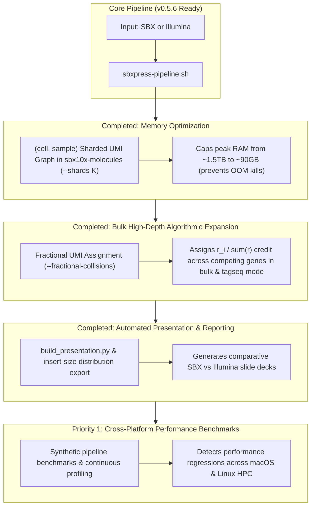

# `sbxpress` Master Roadmap & Execution Plan

> **Status**: Updated as of v0.5.9 (2026-10-07). Consolidates all historic plans (`docs/archive/FLEX_SUPPORT_PLAN.md`, `docs/archive/GENE_COLLISION_RESOLUTION_PLAN.md`, `docs/archive/OVERLAP_PLAN.md`, `docs/archive/PRESENTATION_PLAN.md`, `PIPELINE_NOTES.md`) into a single master tracking document.

---

## 1. Completed Milestone Matrix (v0.3.3 → v0.5.6)

| Feature / Milestone | Module / Binary | Version | Status |
| :--- | :--- | :--- | :--- |
| **Standard 10x 3′ GEX Pipeline** | `extract`, `minimap2`, `annotate`, `molecules`, `matrix`, `cells` | `v0.3.4` | 🟢 **Completed** |
| **Illumina PE Overlap & YC Tagging** | `sbxpress illumina --overlap`, `sbx10x::yc` | `v0.3.7` | 🟢 **Completed** |
| **CAT Tagseq Molecule & Cell Calling** | `molecules --tagseq`, `cells --tagseq-barcodes` | `v0.3.8` | 🟢 **Completed** |
| **10x Flex Probe Demux & Composite Barcoding** | `sbxpress probe-demux`, `matrix --probe-barcodes` | `v0.4.0` | 🟢 **Completed** |
| **CRISPR Feature Capture & GMM Thresholding** | `feature_capture.rs`, `sbxpress protospacer-call` | `v0.5.0` | 🟢 **Completed** |
| **10x Flex Probe-Set Alignment Engine** | `sbxpress probeset-align` (`src/probe_set.rs`) | `v0.5.0` | 🟢 **Completed** |
| **Illumina + Flex / Tagseq Integration Tests** | `tests/illumina_modes_integration.rs` | `v0.5.2` | 🟢 **Completed** |
| **Native Multi-Threading in `probeset-align`** | `sbxpress probeset-align --threads N` (Rayon pool) | `v0.5.3` | 🟢 **Completed** |
| **Unified Pipeline Driver Script** | `scripts/sbxpress-pipeline.sh` (2 input × 3 analysis modes) | `v0.5.4` | 🟢 **Completed** |
| **Hot-Path Microbenchmark Suite Expansion** | `benches/pipeline_hot_paths.rs` (`ProbeMatcher`) | `v0.5.5` | 🟢 **Completed** |
| **Master Roadmap & Plan Consolidation** | `FUTURE_ROADMAP.md` & historic plan header consolidation | `v0.5.6` | 🟢 **Completed** |
| **Sharded Peak Memory Bounding** | `sbx10x-molecules --shards K` | `v0.5.6` | 🟢 **Completed** |
| **Fractional UMI Collision Resolution** | `molecules --fractional-collisions` & `cr_bam_to_mtx` `ZW:f` | `v0.5.6` | 🟢 **Completed** |
| **Automated Presentation & Reporting** | `scripts/build_presentation.py` & insert-size export | `v0.5.6` | 🟢 **Completed** |

---

## 2. Open Technical Enhancements & Future Roadmap

---

### Priority 1 (Completed v0.5.6): Bounding Peak Memory in `sbx10x-molecules`

- **Status**: 🟢 **Completed in v0.5.6**.
- **Implementation**: `--shards K` partitions evidence by `hash(cell, sample) % K`, sequentially executing collate $\rightarrow$ UMI correction $\rightarrow$ gene collision resolution $\rightarrow$ BAM writing per shard, bounding peak RSS by $\text{total} / K$.

---

### Priority 2 (Completed v0.5.6): Fractional UMI Collision Assignment for High-Depth Bulk & Tagseq Modes

- **Status**: 🟢 **Completed in v0.5.6; reworked after review** (the 0.5.6–0.5.8 implementation crashed on real BAMs and wrote no representatives — see CHANGELOG 0.5.9).
- **Implementation**:
  1. Added `--fractional-collisions` to `sbx10x-molecules`. Was the `--tagseq` default in 0.5.6–0.5.9; opt-in since, after review showed it undercounts when collisions are chance events (Shared is the default; see also `--position-aware-umis` and `scripts/compare_tagseq_modes.sh`).
  2. For colliding genes $g_1 \dots g_k$ with read counts $r_1 \dots r_k$, assigns proportional credit $w_i = r_i / \sum r$, tagging records with `XW:A:F` and floating-point weight tag `ZW:f:<weight>` (`ZG` stays `annotate`'s gene call). `sbxpress cells` reads the resulting `f32` matrices without truncation.
  3. Updated `cr_bam_to_mtx` matrix materialization to parse `ZW:f` weight tags and output `real` Matrix Market MTX (`%%MatrixMarket matrix coordinate real general`) and `f32` CSC HDF5 matrices (`raw_feature_bc_matrix.h5`).

---

### Priority 3 (Completed v0.5.6): Automated Slide Deck & Insert-Size Reporting

- **Status**: 🟢 **Completed in v0.5.6**.
- **Implementation**:
  1. Added `--export-insert-sizes` and `--report-dir` options to `scripts/build_presentation.py`.
  2. Ingests Illumina, molecules, and cell calling metrics JSON files, exporting cDNA insert-length distribution TSVs and dynamically generating 10-slide PowerPoint presentations (`.pptx`).

---

### Priority 4: Cross-Platform Performance Benchmarks & Continuous Profiling

- **Context** ([`PROFILING.md`](PROFILING.md)):
  Criterion microbenchmarks in [`benches/pipeline_hot_paths.rs`](benches/pipeline_hot_paths.rs) run locally using synthetic data without external network dependencies (~740 ns/read, ~1.35M reads/sec/core for `ProbeMatcher::locate`). Cross-platform performance validation across local development (macOS) and production high-performance computing (Linux 512-core / 1.5TB RAM) requires continuous profiling tracking.
- **Proposed Architecture**:
  1. Add synthetic end-to-end throughput benchmarks to `benches/pipeline_hot_paths.rs` simulating whole pipeline stages.
  2. Maintain automated profiling scripts wrapping `cargo bench` and CPU/memory instrumentation (`samply`, `perf`).
- **Expected Impact**: Catches performance regressions in hot-path sequence parsing and alignment prior to deployment on production HPC clusters.

### Priority 5: Evaluate TSO Trimming (follow-up raised 2026-10-13)

- **Status (2026-10-16, 0.6.3): steps 1-2 done; do not adopt.** The audit
  (`cat02_matched_depth/tso_audit`) found the TSO at the read's 5' end in
  9.7% (Illumina), 8.0% (SBX 3') and 5.6% (SBX 5') of mapped reads, always
  soft-clipped. 0.6.3 adds `illumina --trim-tso` for unmerged R2 (off by
  default). On a 2 M-read subset per arm (`cat02_matched_depth/
  tso_trim_test`) trimming cost Illumina 0.59% of countable reads (same
  alignments, lower MAPQ) and changed nothing for SBX. Step 3 (an
  indel-tolerant detector for both layouts) has no payoff for counting;
  revisit only if a consumer needs TSO-free sequence (e.g. 5' end
  analysis).

- **Context**: No path trims the template-switch oligo by default.
  `sbxpress extract --trim-tso` is off ("enabling it changes emitted cDNA,
  so measure the delta before adopting"). `sbxpress illumina --trim-tso`
  acts only on merged pairs (`--overlap`), and `sbxpress-pipeline.sh` passes
  neither flag, so unmerged Illumina R2 is never TSO-trimmed. Poly-A/T is
  already handled: `extract` keeps only the cDNA between the dT run and the
  adapter, and `illumina` trims R2 poly-A read-through by default (90%-A
  tail, 0.6.2). minimap2 soft-clips an untrimmed TSO (~30 nt, non-genomic,
  ending GGG), so the expected cost is a shorter aligned span (lower MAPQ or
  an unmapped short read) rather than misplacement. The TSO is present only
  on fragments that reach the transcript 5' end, so it is likely more common
  in short fragments and in the SBX 5p library.
- **Design notes** (user review, 2026-10-13):
  1. In 3' expression the TSO is at the far end of the molecule from the
     CB/UMI (and dT). For Illumina, that is where read 2 starts: on a
     fragment reaching the transcript 5' end, R2 begins in the TSO. Finding
     it does not depend on merging mates, so the current restriction of
     `illumina --trim-tso` to `--overlap` merged pairs has no structural
     reason; unmerged R2 should be checked too (5' end of R2).
  2. In 5' expression the layout is reversed: the TSO sits next to the
     CB/UMI, where 3' chemistry has the dT/poly-T, and the poly-A is at the
     far end. Any TSO or poly-A/T detection should therefore handle both
     sequences in either position (CB-adjacent or far end), chosen by
     chemistry, rather than hard-coding the 3' layout.
- **Proposed Work**:
  1. Run `sbxpress audit` on the CAT02 matched-depth annotated BAMs
     (`sbxpress_validation/cat02_matched_depth`: Illumina, SBX 3p, SBX 5p),
     which reports TSO in 5'/3' soft clips as a share of mapped reads.
  2. On a subset of each library, compare with and without TSO trimming
     (`extract --trim-tso`; for Illumina, TSO trimming at the start of
     unmerged R2, which needs a code change per design note 1) on eligible
     reads, molecules, cells and per-gene counts.
  3. Build the detector for both layouts (design note 2) so 5' expression
     uses the same code with the TSO and dT/poly-A roles swapped.
  4. Adopt as a default only if the gain is measurable and nothing is lost.
- **Expected Impact**: Decides whether TSO trimming should be on by default
  for each input mode, with data behind it.

### Priority 6: Genes Undercounted vs Cell Ranger by Annotation and X/Y Homology (raised 2026-10-14)

- **Context**: In the CAT02 M2_GEX matched-depth Illumina comparison
  (`sbxpress_validation/cat02_matched_depth/report.md`), sbxpress with
  minimap2 `-x splice:sr -m 20 -s 30` reached 79% of Cell Ranger's UMIs in
  cells, with per-gene r 0.977. A few genes stay far below Cell Ranger at
  every mapping and MAPQ setting tried, so the cause looks like annotation
  or the X/Y reference rather than mapping. UMI totals below are over cells
  both runs call (Cell Ranger vs sbxpress):
  - ANKUB1: 19,359 vs 119. The GENCODE v44 *basic* GTF used by sbxpress has
    2 of the 9 transcripts in Cell Ranger's 2024-A GTF. Overall, basic has
    117,747 transcripts vs 226,005, so reads in exons missing from basic fall
    outside the gene or become intergenic.
  - IL3RA: 4,439 vs 105. It sits in the X/Y pseudoautosomal region (PAR1).
    If both chrX and chrY PAR copies are present, reads align equally well
    to both, get MAPQ 0, and the MAPQ >= 60 rule drops them.
  - PCDH11X: 66,291 vs 10,759. It has a near-identical chrY copy
    (PCDH11Y, X-transposed region), so it is likely the same low-MAPQ effect.
  - ENSG00000289474 (a 116-base lncRNA inside KIF5C): Cell Ranger gives it
    about 100 K UMIs where sbxpress sees about 3.7 K reads. This may be a
    Cell Ranger placement artifact rather than an sbxpress loss; check
    before "fixing".
- **Proposed Work**:
  1. Re-annotate the existing Illumina BAM with Cell Ranger's 2024-A
     `genes.gtf` (or full GENCODE v44 with the same biotype filters) and
     measure how much of the gap closes, especially ANKUB1. Decide whether
     the documented reference should move off the *basic* GTF.
  2. Check how the reference handles chrY PAR. If both copies are present,
     either mask the chrY PARs in the minimap2 index (as is common for
     RNA-seq references) or treat PAR multi-mapping X/Y pairs as one locus.
     Confirm what Cell Ranger 2024-A does (the earlier "chrY PAR masking for
     the CAT02 Cell Ranger comparison" item).
  3. For X/Y homolog pairs outside the PAR (PCDH11X/Y), measure how many
     reads are MAPQ 0 between exactly those two genes, and consider an
     `annotate` rescue like `mm:i:1` when all hits fall on one gene pair.
- **Expected Impact**: Closes a gene-specific part of the Illumina gap to
  Cell Ranger and removes systematic undercounting of sex-chromosome
  homologs, which matters for any sex-aware analysis.
