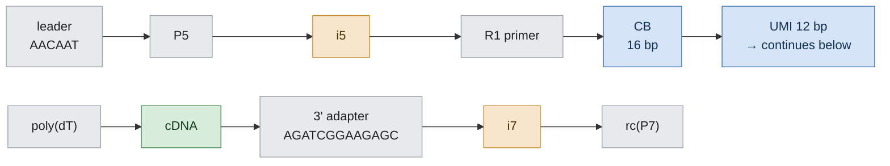
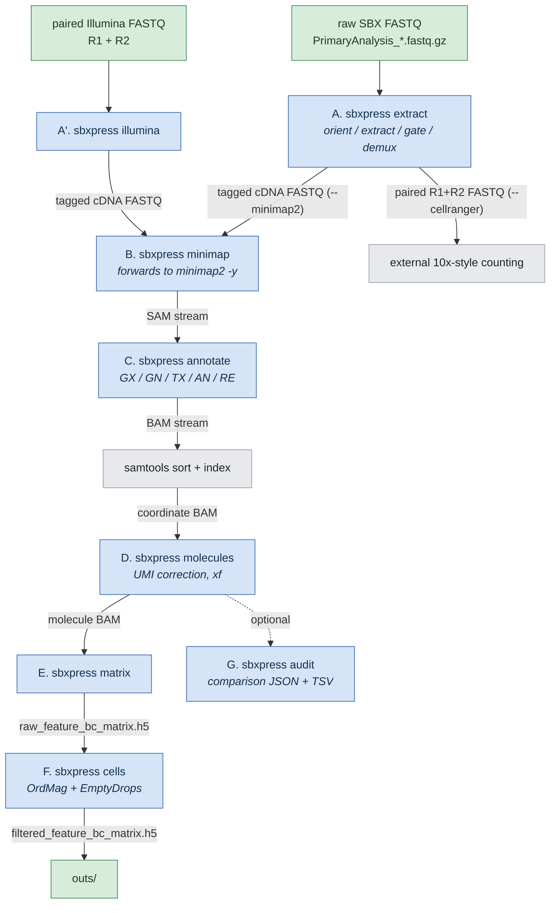
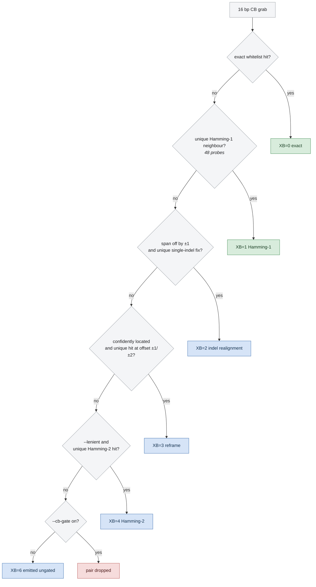

# sbxpress — Full Technical Description

**Prepared for third-party intellectual-property assessment (Roche).**

| Item | Value |
|---|---|
| Software name | `sbxpress` (Cargo package `sbxpress`; library crate `sbx10x`) |
| Version described | 0.5.9 |
| Source revision | `v0.5.9` (2026-10-07) |
| Implementation language | Rust (edition 2021), built with rustc 1.96.0 |
| License of original code | BSD 3-Clause (see `LICENSE`) |
| Copyright holder | UCSF Biochem — Center for Advanced Technology (2026) |
| Supported platforms | Ubuntu/Debian-family Linux, macOS (x86-64 and arm64) |
| Original source size | ~19,400 lines of Rust across 25 library modules and 11 binaries, plus ~1,500 lines of shell/Python tooling |

This document describes what the software does, how each stage operates
algorithmically, what it reads and writes, and every dependency it carries —
Rust crates (direct and transitive, with license identifiers), vendored native C
libraries, external executables, and third-party reference data.

---

## 1. Purpose and problem statement

Roche SBX sequences each library molecule end-to-end as a single long read
(P5 → P7). A 10x Genomics Single Cell library (the validated target is Single
Cell Multiome ATAC+GEX, gene-expression side) is therefore delivered as complete
molecules rather than the paired short reads that the standard 10x analysis
software expects.

`sbxpress` is the bridge. It:

1. parses each SBX molecule into its structural parts;
2. recovers the cell barcode (CB), UMI, and cDNA insert;
3. demultiplexes by sample index (i5/i7);
4. emits either standard 10x-style paired R1/R2 FASTQs, or a tag-carrying
   cDNA-only FASTQ for direct long-read alignment; and
5. carries that output all the way through alignment, gene annotation, UMI
   correction/molecule calling, raw count-matrix construction, and cell calling,
   producing a conventional `outs/` directory of 10x-style Matrix Market and HDF5
   matrices.

A second, symmetric input path (`sbxpress illumina`) converts conventional paired
Illumina 10x FASTQs into the same internal contract, so that SBX and Illumina data
for the same library can be processed through byte-identical downstream code and
compared on a matched-platform basis.

### Library molecule model

The read structure assumed by the parser is:

```
leader – P5 – i5 – R1primer – CB(16) – UMI(12) – polyT – cDNA – adapter – i7 – rc(P7)
```

Anchor constants are centralized in `src/anchors.rs` as the single source of
truth:

| Constant | Sequence | Role |
|---|---|---|
| `SBX_LEADER` | `AACAAT` | SBX leader, 5′ of P5/P7 on intact reads |
| `P5` | `AATGATACGGCGACCACCGAGAT` | P5 library end |
| `R1_PRIMER` | `ACACTCTTTCCCTACACGACGCTCTTCCGATCT` | immediately precedes CB+UMI |
| `R1_PRIMER_TAIL` | `CTTCCGATCT` | 10 bp 3′ tail used as the cheap bracket confirm |
| `R2_PRIMER` | `GTGACTGGAGTTCAGACGTGTGCTCTTCCGATCT` | immediately precedes cDNA on the 3′ side |
| `P7` | `CAAGCAGAAGACGGCATACGAGAT` | P7 library end |
| `TSO` | `AAGCAGTGGTATCAACGCAGAGTACATGGG` | template-switch oligo (5′ assay; detection only) |
| `ILLUMINA_3P_ADAPTER` | `AGATCGGAAGAGC` | universal 3′ read-through adapter — marks cDNA end |

**Figure 1 — SBX molecule anatomy and what each stage consumes.** Colour marks
destination: grey = structural landmark used only as an anchor, blue = emitted as
R1 (CB+UMI), green = emitted as R2 (cDNA), amber = consumed by demultiplexing.



The poly(dT) run is the structural pivot: it is found in O(n) with no alignment,
and it simultaneously establishes orientation, the 3' end of the CB+UMI bracket,
and the 5' start of the cDNA.

These are standard Illumina/10x library sequences plus a working value for the
SBX leader. The source notes that the exact/full SBX leader and adapter set is
still to be confirmed with Roche; the current values were derived empirically
from the data.

---

## 2. Top-level architecture

### 2.1 Distribution model

A single public executable, `sbxpress`, is installed to `<prefix>/bin`. It is a
thin dispatcher (`src/bin/sbxpress.rs`, ~120 lines) that `exec`s one of seven
private engine binaries installed to `<prefix>/libexec/sbxpress/`. Dispatch at
the process boundary preserves each engine's streaming and memory behavior while
presenting one stable CLI.

| Public subcommand | Engine binary | Source |
|---|---|---|
| `sbxpress extract` | `sbx10x` | `src/main.rs` + `src/lib.rs` and modules |
| `sbxpress illumina` | `sbxpress-illumina` | `src/bin/sbxpress-illumina.rs` |
| `sbxpress minimap` | (none — forwards argv to the system `minimap2`) | `src/bin/sbxpress.rs` |
| `sbxpress annotate` | `sbx10x-annotate` | `src/annotate_bam.rs` |
| `sbxpress molecules` | `sbx10x-molecules` | `src/bin/sbx10x-molecules.rs` |
| `sbxpress audit` | `bam-audit` | `src/bin/bam-audit.rs` |
| `sbxpress matrix` | `cr-bam-to-mtx` | `src/cr_bam_to_mtx.rs` |
| `sbxpress cells` | `sbxpress-cells` | `src/cell_calling.rs` |

Helper location is resolved from `SBXPRESS_LIBEXEC`, else `<prefix>/libexec/sbxpress`,
else the Cargo `target/` directory. The dispatcher sets `SBXPRESS_DISPATCH=1` so
engines re-brand their `--help` under the public command name.

### 2.2 Library modules (`src/`)

| Module | Lines | Role |
|---|---|---|
| `anchors.rs` | 100 | Adapter/primer/leader constants; Hamming helpers; reverse-complement |
| `homopolymer.rs` | 104 | poly(dT)/poly(A) run detection (the CB/cDNA boundary anchor) |
| `orient.rs` | 721 | Per-read orientation to canonical P5→P7; CB+UMI bracket location |
| `extract.rs` | 389 | R1/R2 bracketing; indel-tolerant 3′ adapter trimming |
| `barcode.rs` | 434 | Whitelist load; CB classification, gating, and three rescue paths |
| `demux.rs` | 365 | i5/i7 extraction and offset-tolerant sample-sheet matching |
| `sample_sheet.rs` | 460 | BCL Convert v2 / flat CSV sample-sheet parsing and normalization |
| `io.rs` | 196 | FASTQ discovery; single-member gzip output writers |
| `accounting.rs` | 109 | Metrics aggregation → `metrics_summary.json` |
| `pipeline.rs` | 57 | Core per-read types and state |
| `config.rs` | 282 | CLI definition, chemistry constants, runtime parameters, presets |
| `lib.rs` | 1,291 | Orchestration: parallel execution, per-read pipeline, emission |
| `annotate_bam.rs` | 1,370 | GTF loading/filtering, feature assignment, BAM tagging |
| `cr_bam_to_mtx.rs` | 591 | Molecule-representative counting → MEX/HDF5 matrices |
| `cell_calling.rs` | 677 | OrdMag + multinomial EmptyDrops cell calling |

### 2.3 End-to-end data flow

**Figure 2 — End-to-end dataflow.** Edge labels give the format handed to the
next stage. Both input paths converge on one tagged-cDNA contract, after which
every stage is shared.



---

## 3. Stage A — `sbxpress extract` (raw SBX → FASTQ)

The single largest and most SBX-specific component. One pass over the raw reads
performs orientation, extraction, barcode gating, demultiplexing, and emission.

### 3.1 Input discovery and execution model

`io::discover_fastqs` expands each `--fastqs` argument: a directory is scanned
non-recursively for `*.fastq.gz` / `*.fq.gz` / `*.fastq` / `*.fq`; explicit files
are taken as given. The list is sorted and de-duplicated, which is part of what
makes runs deterministic.

Because serial gzip inflate caps one file to one core, the executor adapts to the
file count (overridable with `--reader-threads`):

* **Many files (files ≥ workers).** One file per worker thread via `rayon`; each
  thread decodes and processes its own file.
* **Few files (files < workers, e.g. one large file).** Decode is decoupled from
  processing: one reader thread per file streams flat-packed record batches over
  a bounded `crossbeam-channel` to the full worker pool, so a single-file run
  still saturates every core. Batches carry the source file's enforced
  orientation.

Output remains mate-ordered (the Nth R1 record is always the mate of the Nth R2)
in both modes; the pipelined path does not preserve input record order within a
file. Identical inputs and parameters give byte-identical FASTQ output.

FASTQ parsing uses `needletail`; gzip uses `flate2` with the zlib backend.

### 3.2 Orientation (`orient.rs`)

Each SBX run is orientation-pure (empirically ~98% P7-led in one run, ~95%
P5-led in another), but the two runs of one library are opposite strands. Three
modes exist (`--orientation auto|p5-led|p7-led`); `auto` detects the dominant
orientation per file and then *enforces* it, so that a cDNA-internal homopolymer
of the wrong identity or position cannot hijack the call.

Per read, the ordered strategy is:

1. **Homopolymer-first (common path).** The 3′ GEX dT-primer (~30 nt) sits
   immediately 3′ of the CB+UMI block. `homopolymer::longest_run` finds the
   longest near-homopolymer run of a given base in O(n) single pass, tolerating
   *isolated* single mismatches (a run breaks only on two consecutive non-matching
   bases). A qualifying poly-T (canonical) or poly-A (reversed) run of at least
   `--min-homopolymer` (default 12) both orients the read and brackets the CB+UMI
   block. No adapter alignment is performed on the hot path.
2. **Bracket confirmation and locking.** The 10 bp `R1_PRIMER_TAIL` is slid over a
   ±6 bp window around the homopolymer-implied bracket start; the offset with the
   best match within `--r1-tail-max-mm` (default 2) fixes `cb_start` exactly. This
   absorbs dT-boundary fuzz (e.g. a UMI ending in T bleeding into the run) without
   a full alignment.
3. **Fallback (`--orient-fallback`).** For reads with no qualifying homopolymer:
   `hamming-tail` (default) does a windowed, allocation-free Hamming scan for the
   10 bp R1-primer tail in the read ends; `levenshtein` runs a full R1-primer
   Levenshtein search on both strands via `triple_accel`; `off` marks such reads
   Unknown. Benchmarks recorded in-source (300k real reads/run) show the Hamming
   tail recovers as many or more reads at roughly 1/20th the cost of the
   Levenshtein path, which is why the expensive path is deliberately not the
   default.

The result (`Oriented`) carries the canonical sequence and quality (borrowed when
no flip is needed, owned reverse-complement when flipped), the orientation, the
method used, leader presence, the poly-T start, the CB+UMI interval, and whether
the R1-tail bracket confirm passed. A 5′ (TSO-spacer) assay path is stubbed and
not implemented.

### 3.3 Extraction and trimming (`extract.rs`)

Operating on the canonical read and reusing the coordinates orientation already
found — no new search:

* **R1** = the 28 bp CB+UMI block.
* **cDNA start** = one past the last base of the dT-primer run, re-extended
  rightward from the approximate start with ±1 probe and isolated-mismatch
  tolerance.
* **cDNA end** = the leftmost 3′ read-through adapter (`AGATCGGAAGAGC`) match at
  or after the cDNA start, or the read end if absent.

Adapter detection (`find_adapter`) is allocation-free and handles three cases:

1. full-length match within `--adapter-max-mm` (default 2) substitutions, using an
   early-exiting Hamming test;
2. full-length match with a **single indel** plus ≤ `max_mm` substitutions — SBX
   makes indel errors in homopolymers (e.g. `AAGAGC` → `AAAGAGC`), which a pure
   Hamming seed misses because the insertion frame-shifts it. The indel check is
   gated on a cheap, indel-safe 3 bp prefix anchor, then verified by trying every
   single-insertion and single-deletion alignment;
3. a **partial adapter** of ≥ 7 bp running off the 3′ end, with the mismatch
   budget scaling with overlap (7 bp must be exact; 8+ bp allow one mismatch).
   In-source measurement puts false trims at ~0.04%, costing a few 3′ bases, while
   leaving an adapter risks crashing downstream trimmers.

All positions are returned as ranges into the canonical sequence (zero-copy). The
whole adapter-trimmed fragment is retained here; any `--max-r2-len` cap is applied
at write time, after reverse-complementation, so the retained bases are the ones
an R2 primer would actually read. Fragments shorter than `--min-cdna-len`
(default 50) are treated as no-cDNA.

### 3.4 Cell-barcode gate and rescue (`barcode.rs`)

The whitelist is loaded from a single-column (or tab-first-column) `.txt`/`.txt.gz`
file. Each 16 bp barcode is 2-bit packed into a `u32` and stored in an `FxHashSet`
for O(1) membership. `FxHash` (multiply+rotate) is used deliberately in place of
the default SipHash; the module notes that with SipHash the set can lose to binary
search on `u32` keys. Barcodes are **not** rewritten in the emitted R1 — correction
is left to downstream tools — but a corrected `CB` tag is emitted in `--minimap2`
mode.

Classification and rescue, in order:

| Route | `XB` code | Method | Default |
|---|---|---|---|
| Exact | 0 | direct set membership | on |
| Hamming-1 | 1 | 48 single-substitution probes, unique hit required | on |
| Indel realignment | 2 | `realign_cb` | on (`--realign`) |
| Reframe | 3 | `reframe_cb` | on (`--cb-reframe`) |
| Hamming-2 | 4 | `correct_within2` (~1080 probes), unique hit required | off (`--lenient`) |
| No whitelist supplied | 5 | — | — |
| Unrescued miss emitted with gating disabled | 6 | — | `--cb-gate false` |

* **`realign_cb` (single-indel rescue).** Triggered by a *structural* signal: the
  measured CB+UMI span is off by exactly ±1 from 28. For an insertion, all 17
  single-base deletions of the first 17 bases are probed; for a deletion, all 4×16
  single-base insertions into the first 15 bases are probed. The corrected barcode
  is accepted only if exactly one whitelist barcode is consistent (correct-or-
  abstain). Documented recovery is ~+1% of reads; recoveries land on real-cell
  barcodes ~4–10× above chance.
* **`reframe_cb` (homopolymer frame-shift rescue).** For confidently located
  CB-fails, frame offsets are tried in the order +1, −1, +2, −2 (offset +1, the
  dominant SBX homopolymer-deletion mode, first) up to `--reframe-window`
  (default 2). The first frame yielding a *unique* within-Hamming-1 whitelist hit
  wins, and the UMI is re-registered off the dT anchor.
* **`--lenient` (Hamming-2).** Off by default; measured at ~51% precision on the
  dense ARC whitelist, so it is only applied to dual-anchor-confirmed CB locations.

**Figure 3 — Cell-barcode gate and rescue ladder.** Evaluated in order; the first
route that yields a *unique* whitelist hit wins, and each rescue abstains rather
than guessing when two whitelist barcodes are equally consistent. `XB` codes are
written into the emitted read's tags, so every barcode's provenance is auditable
downstream.



"Confidently located" means dual-anchor confirmed: a confirmed R1-primer tail on
the 5′ side and a sufficiently long dT run on the 3′ side. This distinction is
recorded in the metrics, because a confidently located whitelist miss is a genuine
base error rather than a mis-location.

With `--cb-gate` on (default), pairs whose CB is neither on-whitelist nor rescued
are dropped.

### 3.5 Demultiplexing (`demux.rs`, `sample_sheet.rs`)

Index positions are derived from coordinates already found, so demux adds no new
search. Empirically validated against 14 known sample indices, in a canonical
P5→P7 read: **i5** sits 10 bp immediately 5′ of the R1 primer as `revcomp(sheet i5)`;
**i7** sits 10 bp after the 3′ adapter as the sheet i7 forward.

Matching uses precomputed ≤`--index-max-mm` (default 1) neighbor maps for O(1)
lookup with explicit ambiguity detection (a neighbor claimed by two samples is
marked ambiguous and never assigns). `--index-window` (default 3) slides the frame
each side to absorb indels in the R1-primer/adapter region that shift the index.
Because the index set has minimum pairwise Hamming distance i7 = 3 and i5 = 4,
single-index assignment is unambiguous and is allowed by default
(`--single-index`) when the other index is truncated — common for i7 on long
reads. Outcomes are recorded as `Dual`, `I5Only`, `I7Only`, `Conflict`, or `None`
(`XI` tag 0–5).

Sample sheets are read in two formats into one normalized model:

* **BCL Convert v2** (primary): `[Reads]` for cycle counts (→ CB/UMI/index
  lengths), `[BCLConvert_Settings]` for `Index2ColumnReverseComplement` and
  barcode mismatches, `[Header]` for `IndexOrientation`, `[BCLConvert_Data]` for
  `Sample_ID,index(=i7),index2(=i5)` with duplicate per-lane rows collapsed.
* **Flat CSV** fallback with header `sample,i7,i5`.

The i5 is stored verbatim plus the reverse-complement flag, and both orientations
are exposed; the matcher confirms empirically which one the SBX-extracted i5
matches. The normalized sheet is written back out as `sample_sheet.csv`.

### 3.6 Emission and output modes

R2 is written **reverse-complemented with reversed quality**, so it follows the
Illumina paired-end convention and maps sense to the gene. The reverse-complement
emit is fused with the length cap, so only the bases that survive the cap are
touched (no intermediate allocation).

Two mutually exclusive presets:

* **`--cellranger`** — paired-FASTQ compatibility preset. Writes
  `<sample>_S<n>_L001_R1_001.fastq.gz` (28 bp CB+UMI) and `_R2_001.fastq.gz`
  (cDNA), and sets `--max-r2-len 649`. The 649 cap exists because the reference
  10x aligner fails at ≥ 650 bp with `quality string length is not equal to
  sequence length`. An explicit flag always overrides a preset value.
* **`--minimap2`** — emits R2 only, with SAM-style tags in the FASTQ comment that
  `minimap2 -y` copies verbatim into SAM/BAM. There is deliberately no R1 file.
  Implies `--processing-tags`.

Tags written into the R2 comment:

| Tag | Meaning |
|---|---|
| `CR` / `UR` | raw cell barcode / raw UMI |
| `CB` | whitelist-corrected cell barcode with the `-1` gem-group suffix |
| `UB` | provisional corrected UMI (pre-gene-aware correction) |
| `CY` / `UY` | raw barcode and UMI Phred qualities |
| `XO` | original SBX read orientation (5 = P5-led, 7 = P7-led) |
| `XB` | barcode route (0–6, table above) |
| `XI` | index route (0–5) |
| `XA` | anchor bitmask: 1 R1-primer tail, 2 poly-T, 4 cDNA adapter trimmed, 8 file-level orientation applied |
| `XL` | extracted cDNA length before capping |

The five `X*` provenance tags are also available in paired mode via
`--processing-tags`; they are placed on R2, the record that gets aligned.

Each output FASTQ is written as a **single gzip member** (the reference 10x
reader mis-frames records at multi-member gzip boundaries). `--split N` shards one
sample across `_001`.. `_00N` files so N writer threads can compress one sample in
parallel; `--gzip-level` (default 4) trades size for throughput, since output
compression is the wall-clock floor at scale.

Unassignable pairs go to `Undetermined_S0_L001_R{1,2}_001.fastq.gz`.

### 3.7 Accounting

`metrics_summary.json` (`accounting.rs`) records output mode, totals, wall-clock
split into load vs. process, reads/sec, thread count, orientation rate, read class
(full/partial/unparseable), pairs emitted, R1 length conformance, adapter-trim
count, R2 length mean/max, and — when the corresponding inputs were supplied — a
whitelist block (size, on-whitelist / within-1 / fail, hit rate, confidently
located counts and percentages, gated-out, realigned, reframed, Hamming-2
corrected) and a demux block (assigned, undetermined, per-route counts, per-sample
pair counts). A human-readable `RUN SUMMARY` is also printed to stderr.

---

## 4. Stage A′ — `sbxpress illumina` (matched-platform input)

`src/bin/sbxpress-illumina.rs` converts standard paired 10x Illumina FASTQs into
the identical tagged-R2 contract used by `extract --minimap2`, so both platforms
share every downstream stage.

* R1 supplies the 16 bp CB and 12 bp UMI; R2 is emitted **unchanged**, since
  Illumina R2 is already in mapping orientation.
* Barcodes are accepted exactly or by uniquely resolvable Hamming-1 correction
  (reusing `sbx10x::barcode`); invalid, absent, and ambiguous barcodes are gated
  out.
* `--r1`/`--r2` repeat once per lane in matching order; pairs are converted
  concurrently under `--threads` (rayon), and each pair produces its own numbered
  output shard (`*.shard-001.fastq.gz`, …). A single pair keeps the requested
  filename.
* Read IDs are canonicalized (whitespace-truncated, `/1`/`/2` stripped) to pair R1
  and R2 records.
* Comments carry `CR`, `CB`, `UR`, `UB`, `CY`, `UY`. A combined JSON report listing
  every shard is written to `<output>.metrics.json`, with per-shard records read,
  records emitted, exact/Hamming-1-corrected/rejected barcodes, and short-R1 counts.

---

## 5. Stage B — `sbxpress minimap` (alignment)

`sbxpress minimap` is a transparent pass-through: it executes the system
`minimap2` with the user's arguments and streams forwarded. **No minimap2 code is
embedded, vendored, or modified.** The production invocations are:

```bash
# SBX long cDNA
sbxpress minimap -a -x splice:sr --junc-bed junctions.bed --secondary=no -y \
  -t 32 GRCh38.splice-sr.mmi extracted_R2.fastq.gz

# multimap-diagnostic mode: primary + 10 secondaries
sbxpress minimap -a -x splice:sr --junc-bed junctions.bed -N 10 -y ...
```

`-y` is what carries the FASTQ-comment tags into SAM/BAM. The junction BED is
produced from the reference GTF with `paftools.js gff2bed` (run under `k8`), per
`REFERENCE_PREPARATION.md`.

---

## 6. Stage C — `sbxpress annotate` (feature assignment)

`src/annotate_bam.rs` (1,370 lines) adds 10x-compatible annotation tags to a
genomic BAM/SAM. It performs **feature assignment only** — it deliberately does
not correct UMIs or set `xf`, because those require evidence aggregated across
reads sharing a cell/gene/UMI neighborhood.

### 6.1 Reference loading

The GENCODE-style GTF (optionally gzipped) is parsed into genes, transcripts, and
exons. With `--reference-filter` (default on) the loader reproduces the reference
10x GTF-filtering rules while loading: gene/transcript biotype allow-listing,
exclusion of `readthrough_transcript`-tagged transcripts, PAR handling, and — with
`--strip-id-versions` (default on) — removal of Ensembl numeric ID version
suffixes. Features are indexed into fixed 16,384 bp genomic bins for
interval lookup.

`--genes-mtx` writes a canonical gene feature manifest from the filtered GTF on
first use, and on subsequent runs *verifies* byte-for-byte identity rather than
overwriting. Passing that same file to `sbxpress matrix --features` fixes feature
rows across every sample built on that reference.

### 6.2 Per-record assignment

Alignment blocks are derived from the CIGAR (`N` splits blocks; `I`/`S`/`H`/`P`
are skipped). For each block set:

* Transcript compatibility requires every block to be contained in an exon, with
  consecutive blocks in consecutive exons and the intervening junction landing
  exactly on the exon boundaries; a compatible hit yields a transcript-local
  position and a transcript-frame CIGAR (N-ops removed, ops merged, reversed for
  minus-strand transcripts).
* Sense exon hits produce the gene call. If there is no exonic overlap but a
  same-strand gene body is overlapped and `--include-introns` (default on) is set,
  the intronic gene call is used instead.
* Region is classified as `E` (exonic, any exon overlap), `N` (intronic, gene-body
  overlap only), or `I` (intergenic).
* Antisense transcript/gene-body hits are recorded separately.

Tags written:

| Tag | Content |
|---|---|
| `GX` / `GN` | `;`-joined compatible gene IDs / names |
| `TX` | `;`-joined compatible transcripts (`ID,strand,pos,cigar`, or `ID,+` for intronic) |
| `AN` | antisense equivalents |
| `RE` | region character `E` / `N` / `I` |
| `XC` / `XT` | gene / transcript collision degree (always emitted; local-use tags) |
| `ZG` / `ZT` / `XP` | with `--three-prime` only: the subset of genes/transcripts supported by a strand-aware terminal exon, and its degree |
| `NH` / `HI` / `mm` | with `--multimap-tags` only |

`ZG`/`ZT`/`XP` are explicitly **non-destructive preference signals**: they never
remove an alignment or rewrite `GX`/`TX`, and are absent unless `--three-prime` is
given. Existing barcode/UMI tags are preserved in all modes.

### 6.3 Execution modes

* **Ordered (default).** Input record order is preserved.
* **`--unordered`.** Records are annotated in `--batch-size` (default 8,192)
  batches across `--threads` rayon workers and emitted as workers finish; intended
  for pipelines that immediately coordinate-sort. This is the fast production path.
* **`--multimap-tags`.** Input must be query-grouped minimap2 output (primary plus
  secondaries retained with `-N`). Each query group is annotated together, and the
  stage writes `NH` = number of *reported* primary+secondary hits, `HI` = hit
  index, and `mm:i:1` when multiple reported hits resolve to exactly one compatible
  gene. It preserves minimap2's native MAPQ rather than applying the reference
  aligner's MAPQ=255 promotion, so `mm` records the equivalent gene-rescue
  condition rather than an identical mapping action. This mode is necessarily
  sequential and mutually exclusive with `--unordered`; it avoids a name-sorted
  intermediate BAM.

Input and output both accept `-` (stdin/stdout BAM), which is what allows the
single-sort streaming pipeline `minimap → annotate → samtools sort`. All logging
goes to stderr so a stdout BAM stream stays byte-valid. A JSON metrics file
(default `<output>.metrics.json`) records GTF filtering counts and per-region /
per-tag annotation counts.

---

## 7. Stage D — `sbxpress molecules` (UMI correction and molecule calling)

`src/bin/sbx10x-molecules.rs`. Input is the coordinate-sorted annotated BAM; it
makes two passes and preserves input order in the output.

1. **Evidence collection.** Every eligible record contributes to a
   `(CB, gene, raw UMI)` key. Barcodes and UMIs are 2-bit packed into a `u64` with
   the length stored in the high byte (supporting up to 28 bases), giving cheap
   hashing and a masked-XOR Hamming distance. Per key the stage tracks read count,
   and the best record by MAPQ then aligned-base count (with a record ordinal as a
   deterministic tie-break).
2. **UMI correction within `(CB, gene)`.** Keys are sorted by descending read
   support and then by UMI. A UMI is attached to a Hamming-1 neighbor only if that
   neighbor's support is at least `2 × support − 1` — the standard 10x directional
   "2n−1" rule — with the higher-support (then lexicographically preferred)
   candidate winning, and parents resolved transitively to a root.
3. **Cross-gene collision resolution.** Corrected `(CB, UB)` pairs landing on more
   than one gene are resolved by total read support. The winner is `W`, losers are
   `L`, an unresolved equal-support tie is `T`, and a singleton is `U`. Ties are
   **not** counted.
4. **Representative marking.** Exactly one record per resolved molecule — the best
   by MAPQ, then aligned bases — is marked as the counted representative.

Tags written: `UB` (corrected UMI), `xf` = 17 for eligible records and 25 for the
representative (bit 8 = "counted", matching the reference convention), `XV` =
molecule-level gene collision degree, `XW` = `U`/`W`/`L`/`T` outcome. A JSON
metrics file records records processed, raw cell-gene-UMI keys, collapsed UMI
nodes, corrected UMI nodes, molecules before and after gene resolution, and
outcome counts.

---

## 8. Stage E — `sbxpress matrix` (raw count matrix)

`src/cr_bam_to_mtx.rs` reconstructs a 10x-style raw gene-expression matrix from a
molecule-annotated BAM by counting `xf` bit-8 representatives using the corrected
`CB`, `UB`, `GX`, and `GN` tags. It works equally on a reference-produced
`possorted_genome_bam.bam` and on an sbxpress molecule BAM, which is what makes
direct pipeline-vs-reference matrix comparison possible.

* `--features` takes a `features.tsv[.gz]` / `genes.mtx` template so zero-count
  feature rows and the reference row order are preserved.
* `--barcodes` takes a barcode template, or `--cell-barcodes` takes a whitelist
  (preserving whitelist order, adding the `--gem-group` suffix, emitting
  zero-count columns for absent barcodes). Without a template, only observed
  features/barcodes can be recovered.
* `--genome` supplies the feature genome label, which cannot be recovered
  reliably from a BAM.

Counts are held in a `BTreeMap<(barcode index, feature index), u64>` so Matrix
Market output emerges in the reference's column-major order. Outputs:

```
outs/
├── raw_feature_bc_matrix/{barcodes,features}.tsv.gz, matrix.mtx.gz
├── raw_feature_bc_matrix.h5      (10x CSC layout, via HDF5)
└── metrics_summary.json
```

`--no-gzip` writes plain `.tsv`/`.mtx`. A `RUN SUMMARY` is printed to stderr.

---

## 9. Stage F — `sbxpress cells` (cell calling)

`src/cell_calling.rs` implements the two-stage 10x GEX cell-calling procedure on
the raw HDF5 matrix, in Rust:

1. **OrdMag.** Barcode UMI totals are sorted; the threshold is 10% of the 99th
   percentile ("order of magnitude") of the top barcodes, evaluated over 100
   bootstrap resamples. When `--expect-cells` is not given, a grid search over
   candidate recovered-cell counts estimates it, subject to a 50-cell floor.
2. **EmptyDrops.** An ambient background profile is built from barcode ranks
   `--ambient-lower`..`--ambient-upper` (defaults 45,000–90,000, the NextGEM/5′
   reference defaults), smoothed with Simple Good-Turing proportion estimation.
   Candidate barcodes above `--emptydrops-minimum-umis` (default 500, raised above
   the observed ambient maximum) are tested against multinomial Monte Carlo
   simulations (`--simulations`, default 100,000) drawn with an alias sampler,
   with log-likelihoods computed via `ln_gamma` (`statrs`). p-values are corrected
   by Benjamini–Hochberg at `--fdr` (default 0.001).

Randomness is a seeded ChaCha8 stream (`--seed`, default 0), so cell calls are
reproducible. `--force-cells N` selects exactly the top N nonzero barcodes and
skips EmptyDrops entirely.

Outputs: `filtered_feature_bc_matrix/`, `filtered_feature_bc_matrix.h5`,
`filtered_barcodes.csv`, `cell_calls.csv`, and `cell_calling_metrics.json`
(algorithm, raw/nonzero barcode counts, recovered cells, OrdMag cells and cutoff,
ambient rank window and barcode counts, thresholds).

---

## 10. Stage G — `sbxpress audit` (comparison metrics)

`src/bin/bam-audit.rs` is a single-pass, O(1)-memory audit designed so that a
multi-hundred-GB BAM can be summarized on the server and only a small JSON moved
back for analysis. Globally and per 25 bp read-length bin (29 bins, 0–700+) it
reports:

* **mapping** — unique (`NH==1`), MAPQ 255, unmapped; MAPQ and `NH` ambiguity
  distributions;
* **annotation** — `RE` region, `GX` gene call, multi-gene ambiguity, gene and
  transcript compatibility degrees;
* **fidelity** — `nM` mismatches per 100 aligned bases;
* **trimming/contamination** — 5′ and 3′ soft clips and *what they contain*
  (adapter / TSO / polyA / polyT / unexplained) via indel-robust 8-mer matching,
  with a ≥5 bp minimum clip and a 0.8 single-base fraction for homopolymer calls.
  Both motifs are tested at both ends so the result is not biased by the expected
  geometry (because R2 is emitted reverse-complemented, residual 3′ adapter lands
  at the 5′ end and residual polyT lands at the 3′ end as polyA);
* **molecules** — exact `xf` bit/value counts, UMI-corrected records, `XW` outcome
  counts, counted molecules, reads per molecule, a read-support histogram, and a
  read-depth saturation curve; with `--cells`, representatives split into all
  barcodes versus final called cells.

Cross-BAM molecule concordance would normally require a hash map over hundreds of
millions of molecules. Instead `--molecules` dumps a **consistent hash subsample**:
a molecule is emitted iff `hash(CB, UMI) % --molecule-sample == 0`. The same
molecules are therefore selected in every BAM, so dumps can simply be joined at
1/N the size — this is what enables platform-only molecule estimates, gene
agreement, and per-cell/per-gene concordance.

---

## 11. Orchestration script

`scripts/sbxpress-gex-pipeline.sh` is the restart-safe production wrapper for one
demultiplexed sample. It runs extraction once for all supplied device outputs,
then maps, annotates (unordered by default), coordinate-sorts once, resolves
molecules, writes raw counts, and calls cells. Each stage checks for its completed
output and is skipped on rerun. The comparison audit is optional so normal count
generation does not make an extra full-BAM pass. Thread counts are separately
tunable per stage (`--extract-threads`, `--map-threads`, `--annotate-threads`,
`--sort-threads`, `--molecule-threads`) for concurrent runs.

---

## 12. Dependencies

### 12.1 Direct Rust crate dependencies

| Crate | Version | License | Role in sbxpress |
|---|---|---|---|
| `needletail` | 0.5 | MIT | FASTQ parsing |
| `flate2` (zlib feature) | 1.0 | MIT OR Apache-2.0 | gzip input/output |
| `triple_accel` | 0.4 | MIT | SIMD Levenshtein search (opt-in orientation fallback) |
| `rayon` | 1.10 | MIT OR Apache-2.0 | data-parallel worker pools |
| `rustc-hash` | 2 | Apache-2.0 OR MIT | FxHash sets/maps for barcode and audit hot paths |
| `crossbeam-channel` | 0.5 | MIT OR Apache-2.0 | bounded reader→worker record channel |
| `clap` (derive) | 4.5 | MIT OR Apache-2.0 | CLI definition |
| `serde` (derive) | 1.0 | MIT OR Apache-2.0 | metrics serialization |
| `serde_json` | 1.0 | MIT OR Apache-2.0 | JSON metrics output |
| `csv` | 1.3 | Unlicense/MIT | sample-sheet parsing |
| `anyhow` | 1.0 | MIT OR Apache-2.0 | error context |
| `thiserror` | 1.0 | MIT OR Apache-2.0 | typed errors |
| `tracing` | 0.1 | MIT | structured logging |
| `tracing-subscriber` (env-filter) | 0.3 | MIT | log filtering (`RUST_LOG`) |
| `rust-htslib` (bzip2, lzma) | 0.49 | MIT | SAM/BAM/CRAM read/write (wraps htslib) |
| `hdf5` | 0.8.1 | MIT OR Apache-2.0 | HDF5 matrix I/O |
| `hdf5-sys` (static, zlib) | 0.8.1 | MIT OR Apache-2.0 | statically links a bundled HDF5 C library |
| `rand` | 0.8 | MIT OR Apache-2.0 | sampling in cell calling |
| `rand_chacha` | 0.3 | MIT OR Apache-2.0 | seeded, reproducible RNG |
| `statrs` | 0.18 | MIT | `ln_gamma` and statistical functions |
| `tempfile` (dev only) | 3 | MIT OR Apache-2.0 | test fixtures |

Notably, `rust-htslib` is configured with `default-features = false`, so no
network/CURL transport is compiled in; only bzip2 and lzma codec support is
enabled.

### 12.2 Vendored / statically linked native C libraries

These are pulled in through `-sys` crates and compiled from source during
`cargo build`. They are the dependencies with the most distinct licensing
characteristics, and are the ones an IP review should look at most closely.

| Native library | Via crate | Linking | License |
|---|---|---|---|
| **htslib** (samtools/HTS) | `hts-sys` 2.2.0 | compiled and statically linked | MIT (crate); htslib itself MIT/Expat |
| **HDF5** (HDF Group) | `hdf5-src` 0.8.1 (`static` feature) | compiled and statically linked | HDF Group BSD-style license (`ext/hdf5/COPYING`) — **not** an SPDX identifier; review the bundled COPYING |
| **zlib** | `libz-sys` 1.1.29 | linked (system or bundled) | MIT OR Apache-2.0 (crate); zlib itself zlib license |
| **bzip2** | `bzip2-sys` 0.1.13 | compiled and statically linked | MIT/Apache-2.0 (crate); bzip2 itself BSD-style |
| **xz/liblzma** | `lzma-sys` 0.1.20 | compiled and statically linked | MIT/Apache-2.0 (crate); liblzma public domain / 0BSD |

Build-time tooling for these: `cc`, `cmake`, `pkg-config`, `bindgen` (BSD-3-Clause)
and `clang-sys`/`libclang` (Apache-2.0).

### 12.3 External executables required at runtime

Not linked, not vendored, not modified — invoked as separate processes:

| Tool | Version used in development | License | Used by |
|---|---|---|---|
| `minimap2` | 2.31-r1302 | MIT | `sbxpress minimap` (transparent forward) |
| `samtools` | 1.24 (htslib 1.24) | MIT | sorting, indexing, `quickcheck` in the pipeline script |
| `k8` | 0.2.4 (downloaded by `install.sh` from the upstream GitHub release) | MIT | JavaScript runtime for `paftools.js` |
| `paftools.js` | matched to the installed minimap2 version, fetched from the minimap2 repo | MIT | `gff2bed` junction-BED generation for the splice index |

`install.sh` obtains `minimap2` and `samtools` from `apt-get` (Ubuntu/Debian) or
Homebrew (macOS), downloads `k8` and `paftools.js` over HTTPS, installs the Rust
toolchain via `rustup` if `cargo` is absent, builds with `cargo build --release
--locked`, installs the public CLI and the seven private engines, optionally
installs staged barcode files to `<prefix>/share/sbxpress/barcodes/`, and runs a
smoke test. `uninstall.sh` reverses this, preserving the potentially shared `k8`
and `paftools.js` by default.

### 12.4 Third-party reference data (required, not redistributed)

| Data | Source | Notes |
|---|---|---|
| 10x cell-barcode whitelist (`737K-arc-v1.txt.gz`, 736,320 barcodes for the Multiome GEX target; `3M-february-2018.txt.gz` for 3′ v3) | 10x Genomics software/reference distributions | **Not committed to the repository.** `resources/10x_barcodes/.gitignore` ignores every file in the directory except its own README, and `resources/README.md` states these files retain their upstream licensing and redistribution terms. Supplied by the operator at runtime via `--whitelist`. |
| Reference genome FASTA + GENCODE GTF (e.g. GENCODE v44/v50, GRCh38 primary assembly) | GENCODE / Ensembl | Operator-supplied; used to build the minimap2 `.mmi` index and the junction BED |
| minimap2 splice index (`.mmi`) and junction BED | built locally from the above with `minimap2 -d` and `paftools.js gff2bed` | see `REFERENCE_PREPARATION.md` |

No third-party reference data, whitelist, or annotation is embedded in the source
tree or in the built binaries.

### 12.5 Development- and analysis-only dependencies

Not required to build or run the pipeline:

* **Python 3** analysis scripts under `scripts/` and `tests/` — `numpy`, `pandas`,
  `pysam`, `python-pptx`, plus stdlib `gzip`/`json`/`math`/`argparse`/
  `subprocess`/`tempfile`/`collections`/`pathlib`. Used for mapping-evaluation
  reports (`analyze_mapping.py`, `analyze_gx_by_length.py`,
  `bam_audit_report.py`, `compare_downstream.py`), matrix validation
  (`tests/validate_cr_matrix.py`, `tests/validate_cr_bam_to_mtx.sh`), and slide
  generation (`build_presentation.py`).
* **Node.js** deck-building scripts under `presentations/`.
* **Rust `examples/`** — 19 diagnostic binaries (per-read disposition, loss
  taxonomy, CB-distance and index audits, orientation purity, realignment
  precision, whitelist benchmarks, etc.) built only with `cargo run --example`.

### 12.6 Complete transitive Rust dependency inventory

The build resolves to **196 crate packages** (including `sbxpress` itself), pinned
in `Cargo.lock`. The full list with SPDX license expressions, generated from
`cargo metadata` at revision `c906ca1`, is in Appendix A.

License distribution across those 196 packages:

| License expression | Packages |
|---|---|
| MIT OR Apache-2.0 (incl. `MIT/Apache-2.0`, `Apache-2.0 OR MIT`, `Apache-2.0/MIT` spellings) | 124 |
| MIT only | 26 |
| Unicode-3.0 (ICU crates, reached via `url`/`idna`) | 18 |
| Apache-2.0 only (`approx`, `clang-sys`, `nalgebra`, `simba`) | 4 |
| Unlicense OR MIT / Unlicense/MIT | 5 |
| Zlib OR Apache-2.0 OR MIT | 3 |
| Apache-2.0 WITH LLVM-exception OR Apache-2.0 OR MIT | 3 |
| BSD-3-Clause (`bindgen`, `instant`) | 2 |
| BSD-2-Clause OR Apache-2.0 OR MIT (`zerocopy`, `zerocopy-derive`) | 2 |
| ISC (`libloading` ×2) | 2 |
| 0BSD OR MIT OR Apache-2.0 (`adler2`) | 1 |
| MIT OR Zlib OR Apache-2.0 (`miniz_oxide`) | 1 |
| Apache-2.0 OR BSL-1.0 (`ryu`) | 1 |
| (MIT OR Apache-2.0) AND Unicode-3.0 (`unicode-ident`) | 1 |
| MIT OR Apache-2.0 OR LGPL-2.1-or-later (`r-efi`) | 1 |
| File-based license (`hdf5-src` → `ext/hdf5/COPYING`) | 1 |
| Unspecified (`sbxpress` itself — see §14) | 1 |

Points worth flagging for the assessment:

* **`hdf5-src`** is the only dependency without an SPDX license expression; it
  carries the HDF Group's own license file and is *statically linked into the
  shipped binaries*.
* **`r-efi`** offers `LGPL-2.1-or-later` as one option in a disjunction; the
  MIT/Apache-2.0 options are available and apply. It is a UEFI target crate
  reached through `getrandom` and is not compiled for Linux/macOS targets.
* Windows-only crates (`winapi*`, `windows-sys`, `windows-link`, `anstyle-wincon`,
  `find-msvc-tools`, `winreg`) and WASI crates appear in the lockfile as
  target-conditional entries but are not compiled on the supported platforms.
* Every license present is permissive; there is no copyleft obligation in the
  compiled artifact.

---

### 12.7 Non-open-source dependencies

**There are no proprietary or closed-source code dependencies.** Every one of the
196 resolved Rust crates carries a permissive OSI-approved license, and all four
external executables (`minimap2`, `samtools`, `k8`, `paftools.js`) are MIT. The
statically linked native libraries — htslib (MIT), HDF5 (HDF Group BSD-style),
zlib, bzip2, liblzma — are likewise open source. Nothing in the build or runtime
requires a commercial license, a license key, an activation service, or a
network-reachable proprietary service.

Three non-code items sit outside that statement and are the only places a
non-open-source obligation can attach:

| Item | Nature | Status |
|---|---|---|
| 10x Genomics cell-barcode whitelist (`737K-arc-v1.txt.gz`, `3M-february-2018.txt.gz`, …) | Proprietary reference **data** shipped inside 10x software/reference distributions, under 10x's own terms — not an open-source license | **Required at runtime**, operator-supplied via `--whitelist`. Deliberately never committed or redistributed (see §12.4). The installer will copy locally staged copies to `<prefix>/share/sbxpress/barcodes/` if the operator has placed them there. |
| Reference genome + GENCODE/Ensembl annotation | Freely redistributable scientific **data** under its own data terms rather than a software license | Operator-supplied; not embedded in the source tree or binaries |
| 10x analysis software (Cell Ranger / Cell Ranger ARC) | Commercial software under 10x's EULA | **Not a dependency.** `sbxpress` neither links to, invokes, nor bundles it. The `--cellranger` preset only shapes FASTQ output to be readable by it, and the downstream stages reimplement equivalent behavior in Rust so the pipeline runs standalone. |

The practical consequence for an IP assessment: the compiled `sbxpress` binaries
contain only permissively licensed code, with attribution/notice obligations
(notably the statically linked HDF5 library, §12.2 and §14.6) and no copyleft
obligation. The proprietary surface is entirely in operator-supplied reference
data, which the software reads at runtime and never redistributes.

---

## 13. Cross-cutting properties

**Determinism.** Identical inputs and parameters produce byte-identical FASTQ
output. Input file lists are sorted and de-duplicated, tie-breaks in UMI
correction and molecule-representative selection are total orders, the audit
subsample is a pure hash function of `(CB, UMI)`, and cell calling uses a seeded
ChaCha8 stream.

**Resource envelope** (from `INSTALL.md`, measured): 8+ cores recommended;
4 GB RAM minimum, roughly 0.5 GB peak per ~14 worker threads, plus ~50 MB for the
barcode whitelist; peak RAM ≈ threads × output targets × 256 KB + whitelist.
Measured throughput on an Apple M4 Pro (14 cores) is ~142K reads/s single-threaded,
scaling with physical cores; a multi-core node processes tens of billions of reads
in well under two hours.

**Streaming.** Annotation accepts `-` for both input and output, so the production
path performs exactly one coordinate sort for the whole pipeline. The audit is
single-pass and O(1) memory.

**Testing.** Unit tests are embedded in the modules (orientation, extraction,
barcode encode/decode and all three rescue paths, config presets, molecule
correction and collision resolution, cell-calling helpers). `tests/` holds a
matrix-reconstruction validator that asserts a sliced-BAM reconstruction is a
non-overcounting subset of the reference matrix, checkable against three
coordinate-sliced reference fixtures.

---

## 14. Notes and open items relevant to an IP assessment

1. **Original vs. reimplemented.** The SBX-specific parsing logic — orientation
   detection and enforcement, the homopolymer-first anchor with R1-tail bracket
   locking, the indel-tolerant adapter trimmer, the three CB rescue strategies
   (span-gated single-indel realignment, homopolymer reframe, gated Hamming-2), the
   coordinate-reuse index extraction and offset-tolerant demux, the tag-carrying
   FASTQ handoff, and the consistent hash-subsample molecule audit — is original
   work in this repository. The *downstream* stages deliberately reimplement
   published/reference behaviors so that outputs are comparable: the 10x GTF
   filtering rules, the `GX`/`GN`/`TX`/`AN`/`RE`/`xf` tag conventions, the
   directional "2n−1" UMI-correction rule, the Matrix Market / 10x HDF5 CSC layout,
   and the OrdMag + multinomial EmptyDrops cell-calling procedure. These are
   independent Rust implementations written against published behavior and file
   formats; no third-party analysis source code is copied, linked, or vendored.
2. **Compatibility surface, not code.** Interoperability with 10x tooling is
   achieved through file formats, SAM tag conventions, and directory layouts.
   Two documented workarounds target the reference aligner's behavior (the 649 bp
   read cap and single-member gzip framing).
3. **Anchor sequences pending confirmation.** `src/anchors.rs` records that the
   exact and complete SBX leader/adapter set should be confirmed with Roche; the
   present values are working values inferred from data analysis.
4. **Reference data is not redistributed.** Barcode whitelists, genome, and
   annotation are operator-supplied at runtime and explicitly excluded from the
   repository.
5. **Package license metadata gap.** `Cargo.toml` does not carry a `license`
   field, so `cargo metadata` reports the package as unspecified even though the
   repository ships a BSD 3-Clause `LICENSE`. Adding `license = "BSD-3-Clause"` to
   `Cargo.toml` would remove that discrepancy for any automated scan Roche runs.
6. **Statically linked HDF5.** Because `hdf5-sys` is built with the `static`
   feature, the HDF Group's library is compiled into the distributed binaries and
   its attribution/notice requirements travel with them.

---

## Appendix A — Complete transitive Rust dependency inventory

Generated with `cargo metadata --format-version 1` at revision `c906ca1`
(196 packages, including the `sbxpress` package itself). Windows- and
WASI-targeted entries are present in the lockfile but are not compiled on Linux or
macOS.

| Package | Version | License |
|---|---|---|
| `adler2` | 2.0.1 | 0BSD OR MIT OR Apache-2.0 |
| `aho-corasick` | 1.1.4 | Unlicense OR MIT |
| `anstream` | 1.0.0 | MIT OR Apache-2.0 |
| `anstyle` | 1.0.14 | MIT OR Apache-2.0 |
| `anstyle-parse` | 1.0.0 | MIT OR Apache-2.0 |
| `anstyle-query` | 1.1.5 | MIT OR Apache-2.0 |
| `anstyle-wincon` | 3.0.11 | MIT OR Apache-2.0 |
| `anyhow` | 1.0.102 | MIT OR Apache-2.0 |
| `approx` | 0.5.1 | Apache-2.0 |
| `ascii` | 1.1.0 | Apache-2.0 OR MIT |
| `autocfg` | 1.5.1 | Apache-2.0 OR MIT |
| `bindgen` | 0.69.5 | BSD-3-Clause |
| `bio-types` | 1.0.4 | MIT |
| `bitflags` | 1.3.2 | MIT/Apache-2.0 |
| `bitflags` | 2.13.0 | MIT OR Apache-2.0 |
| `buffer-redux` | 1.1.0 | MIT OR Apache-2.0 |
| `bytecount` | 0.6.9 | Apache-2.0/MIT |
| `bytemuck` | 1.25.1 | Zlib OR Apache-2.0 OR MIT |
| `byteorder` | 1.5.0 | Unlicense OR MIT |
| `bzip2` | 0.4.4 | MIT/Apache-2.0 |
| `bzip2-sys` | 0.1.13+1.0.8 | MIT/Apache-2.0 |
| `cc` | 1.2.65 | MIT OR Apache-2.0 |
| `cexpr` | 0.6.0 | Apache-2.0/MIT |
| `cfg-if` | 1.0.4 | MIT OR Apache-2.0 |
| `clang-sys` | 1.8.1 | Apache-2.0 |
| `clap` | 4.6.1 | MIT OR Apache-2.0 |
| `clap_builder` | 4.6.0 | MIT OR Apache-2.0 |
| `clap_derive` | 4.6.1 | MIT OR Apache-2.0 |
| `clap_lex` | 1.1.0 | MIT OR Apache-2.0 |
| `cmake` | 0.1.58 | MIT OR Apache-2.0 |
| `colorchoice` | 1.0.5 | MIT OR Apache-2.0 |
| `crc32fast` | 1.5.0 | MIT OR Apache-2.0 |
| `crossbeam-channel` | 0.5.15 | MIT OR Apache-2.0 |
| `crossbeam-deque` | 0.8.6 | MIT OR Apache-2.0 |
| `crossbeam-epoch` | 0.9.18 | MIT OR Apache-2.0 |
| `crossbeam-utils` | 0.8.21 | MIT OR Apache-2.0 |
| `csv` | 1.4.0 | Unlicense/MIT |
| `csv-core` | 0.1.13 | Unlicense/MIT |
| `custom_derive` | 0.1.7 | MIT/Apache-2.0 |
| `derive-new` | 0.6.0 | MIT |
| `derive-new` | 0.7.0 | MIT |
| `displaydoc` | 0.2.6 | MIT OR Apache-2.0 |
| `either` | 1.16.0 | MIT OR Apache-2.0 |
| `errno` | 0.3.14 | MIT OR Apache-2.0 |
| `fastrand` | 2.4.1 | Apache-2.0 OR MIT |
| `find-msvc-tools` | 0.1.9 | MIT OR Apache-2.0 |
| `flate2` | 1.1.9 | MIT OR Apache-2.0 |
| `form_urlencoded` | 1.2.2 | MIT OR Apache-2.0 |
| `fs-utils` | 1.1.4 | MIT OR Apache-2.0 |
| `getrandom` | 0.2.17 | MIT OR Apache-2.0 |
| `getrandom` | 0.4.3 | MIT OR Apache-2.0 |
| `glob` | 0.3.3 | MIT OR Apache-2.0 |
| `hdf5` | 0.8.1 | MIT OR Apache-2.0 |
| `hdf5-derive` | 0.8.1 | MIT OR Apache-2.0 |
| `hdf5-src` | 0.8.1 | see `ext/hdf5/COPYING` |
| `hdf5-sys` | 0.8.1 | MIT OR Apache-2.0 |
| `hdf5-types` | 0.8.1 | MIT OR Apache-2.0 |
| `heck` | 0.5.0 | MIT OR Apache-2.0 |
| `hts-sys` | 2.2.0 | MIT |
| `icu_collections` | 2.2.0 | Unicode-3.0 |
| `icu_locale_core` | 2.2.0 | Unicode-3.0 |
| `icu_normalizer` | 2.2.0 | Unicode-3.0 |
| `icu_normalizer_data` | 2.2.0 | Unicode-3.0 |
| `icu_properties` | 2.2.0 | Unicode-3.0 |
| `icu_properties_data` | 2.2.0 | Unicode-3.0 |
| `icu_provider` | 2.2.0 | Unicode-3.0 |
| `idna` | 1.1.0 | MIT OR Apache-2.0 |
| `idna_adapter` | 1.2.2 | Apache-2.0 OR MIT |
| `ieee754` | 0.2.6 | MIT/Apache-2.0 |
| `instant` | 0.1.13 | BSD-3-Clause |
| `is_terminal_polyfill` | 1.70.2 | MIT OR Apache-2.0 |
| `itertools` | 0.12.1 | MIT OR Apache-2.0 |
| `itoa` | 1.0.18 | MIT OR Apache-2.0 |
| `jobserver` | 0.1.35 | MIT OR Apache-2.0 |
| `lazy_static` | 1.5.0 | MIT OR Apache-2.0 |
| `lazycell` | 1.3.0 | MIT/Apache-2.0 |
| `libc` | 0.2.186 | MIT OR Apache-2.0 |
| `libloading` | 0.7.4 | ISC |
| `libloading` | 0.8.9 | ISC |
| `libm` | 0.2.16 | MIT |
| `libz-sys` | 1.1.29 | MIT OR Apache-2.0 |
| `linear-map` | 1.2.0 | MIT/Apache-2.0 |
| `linux-raw-sys` | 0.12.1 | Apache-2.0 WITH LLVM-exception OR Apache-2.0 OR MIT |
| `litemap` | 0.8.2 | Unicode-3.0 |
| `lock_api` | 0.4.14 | MIT OR Apache-2.0 |
| `log` | 0.4.33 | MIT OR Apache-2.0 |
| `lzma-sys` | 0.1.20 | MIT/Apache-2.0 |
| `matchers` | 0.2.0 | MIT |
| `matrixmultiply` | 0.3.10 | MIT/Apache-2.0 |
| `memchr` | 2.8.2 | Unlicense OR MIT |
| `minimal-lexical` | 0.2.1 | MIT/Apache-2.0 |
| `miniz_oxide` | 0.8.9 | MIT OR Zlib OR Apache-2.0 |
| `nalgebra` | 0.33.3 | Apache-2.0 |
| `ndarray` | 0.15.6 | MIT OR Apache-2.0 |
| `needletail` | 0.5.1 | MIT |
| `newtype_derive` | 0.1.6 | MIT/Apache-2.0 |
| `nom` | 7.1.3 | MIT |
| `nu-ansi-term` | 0.50.3 | MIT |
| `num-bigint` | 0.4.8 | MIT OR Apache-2.0 |
| `num-complex` | 0.4.6 | MIT OR Apache-2.0 |
| `num-integer` | 0.1.46 | MIT OR Apache-2.0 |
| `num-rational` | 0.4.2 | MIT OR Apache-2.0 |
| `num-traits` | 0.2.19 | MIT OR Apache-2.0 |
| `once_cell` | 1.21.4 | MIT OR Apache-2.0 |
| `once_cell_polyfill` | 1.70.2 | MIT OR Apache-2.0 |
| `parking_lot` | 0.11.2 | Apache-2.0/MIT |
| `parking_lot_core` | 0.8.6 | Apache-2.0/MIT |
| `paste` | 1.0.15 | MIT OR Apache-2.0 |
| `percent-encoding` | 2.3.2 | MIT OR Apache-2.0 |
| `pin-project-lite` | 0.2.17 | Apache-2.0 OR MIT |
| `pkg-config` | 0.3.33 | MIT OR Apache-2.0 |
| `potential_utf` | 0.1.5 | Unicode-3.0 |
| `ppv-lite86` | 0.2.21 | MIT OR Apache-2.0 |
| `proc-macro2` | 1.0.106 | MIT OR Apache-2.0 |
| `quick-error` | 1.2.3 | MIT/Apache-2.0 |
| `quote` | 1.0.46 | MIT OR Apache-2.0 |
| `r-efi` | 6.0.0 | MIT OR Apache-2.0 OR LGPL-2.1-or-later |
| `rand` | 0.8.7 | MIT OR Apache-2.0 |
| `rand_chacha` | 0.3.1 | MIT OR Apache-2.0 |
| `rand_core` | 0.6.4 | MIT OR Apache-2.0 |
| `rand_distr` | 0.4.3 | MIT OR Apache-2.0 |
| `rawpointer` | 0.2.1 | MIT/Apache-2.0 |
| `rayon` | 1.12.0 | MIT OR Apache-2.0 |
| `rayon-core` | 1.13.0 | MIT OR Apache-2.0 |
| `redox_syscall` | 0.2.16 | MIT |
| `regex` | 1.13.0 | MIT OR Apache-2.0 |
| `regex-automata` | 0.4.14 | MIT OR Apache-2.0 |
| `regex-syntax` | 0.8.11 | MIT OR Apache-2.0 |
| `rust-htslib` | 0.49.0 | MIT |
| `rustc-hash` | 1.1.0 | Apache-2.0/MIT |
| `rustc-hash` | 2.1.3 | Apache-2.0 OR MIT |
| `rustc_version` | 0.1.7 | MIT OR Apache-2.0 |
| `rustix` | 1.1.4 | Apache-2.0 WITH LLVM-exception OR Apache-2.0 OR MIT |
| `rustversion` | 1.0.23 | MIT OR Apache-2.0 |
| `ryu` | 1.0.23 | Apache-2.0 OR BSL-1.0 |
| `safe_arch` | 0.7.4 | Zlib OR Apache-2.0 OR MIT |
| `sbxpress` | 0.3.5 | unspecified — BSD-3-Clause per repository LICENSE |
| `scopeguard` | 1.2.0 | MIT OR Apache-2.0 |
| `semver` | 0.1.20 | MIT/Apache-2.0 |
| `serde` | 1.0.228 | MIT OR Apache-2.0 |
| `serde_core` | 1.0.228 | MIT OR Apache-2.0 |
| `serde_derive` | 1.0.228 | MIT OR Apache-2.0 |
| `serde_json` | 1.0.150 | MIT OR Apache-2.0 |
| `sharded-slab` | 0.1.7 | MIT |
| `shlex` | 1.3.0 | MIT OR Apache-2.0 |
| `shlex` | 2.0.1 | MIT OR Apache-2.0 |
| `simba` | 0.9.1 | Apache-2.0 |
| `simd-adler32` | 0.3.9 | MIT |
| `smallvec` | 1.15.2 | MIT OR Apache-2.0 |
| `stable_deref_trait` | 1.2.1 | MIT OR Apache-2.0 |
| `statrs` | 0.18.0 | MIT |
| `strsim` | 0.11.1 | MIT |
| `strum_macros` | 0.26.4 | MIT |
| `syn` | 1.0.109 | MIT OR Apache-2.0 |
| `syn` | 2.0.118 | MIT OR Apache-2.0 |
| `synstructure` | 0.13.2 | MIT |
| `tempfile` | 3.27.0 | MIT OR Apache-2.0 |
| `thiserror` | 1.0.69 | MIT OR Apache-2.0 |
| `thiserror` | 2.0.18 | MIT OR Apache-2.0 |
| `thiserror-impl` | 1.0.69 | MIT OR Apache-2.0 |
| `thiserror-impl` | 2.0.18 | MIT OR Apache-2.0 |
| `thread_local` | 1.1.9 | MIT OR Apache-2.0 |
| `tinystr` | 0.8.3 | Unicode-3.0 |
| `tracing` | 0.1.44 | MIT |
| `tracing-attributes` | 0.1.31 | MIT |
| `tracing-core` | 0.1.36 | MIT |
| `tracing-log` | 0.2.0 | MIT |
| `tracing-subscriber` | 0.3.23 | MIT |
| `triple_accel` | 0.4.0 | MIT |
| `typenum` | 1.20.1 | MIT OR Apache-2.0 |
| `unicode-ident` | 1.0.24 | (MIT OR Apache-2.0) AND Unicode-3.0 |
| `url` | 2.5.8 | MIT OR Apache-2.0 |
| `utf8_iter` | 1.0.4 | Apache-2.0 OR MIT |
| `utf8parse` | 0.2.2 | Apache-2.0 OR MIT |
| `valuable` | 0.1.1 | MIT |
| `vcpkg` | 0.2.15 | MIT/Apache-2.0 |
| `wasi` | 0.11.1+wasi-snapshot-preview1 | Apache-2.0 WITH LLVM-exception OR Apache-2.0 OR MIT |
| `wide` | 0.7.33 | Zlib OR Apache-2.0 OR MIT |
| `winapi` | 0.3.9 | MIT/Apache-2.0 |
| `winapi-i686-pc-windows-gnu` | 0.4.0 | MIT/Apache-2.0 |
| `winapi-x86_64-pc-windows-gnu` | 0.4.0 | MIT/Apache-2.0 |
| `windows-link` | 0.2.1 | MIT OR Apache-2.0 |
| `windows-sys` | 0.61.2 | MIT OR Apache-2.0 |
| `winreg` | 0.10.1 | MIT |
| `writeable` | 0.6.3 | Unicode-3.0 |
| `xz2` | 0.1.7 | MIT/Apache-2.0 |
| `yoke` | 0.8.3 | Unicode-3.0 |
| `yoke-derive` | 0.8.2 | Unicode-3.0 |
| `zerocopy` | 0.8.54 | BSD-2-Clause OR Apache-2.0 OR MIT |
| `zerocopy-derive` | 0.8.54 | BSD-2-Clause OR Apache-2.0 OR MIT |
| `zerofrom` | 0.1.8 | Unicode-3.0 |
| `zerofrom-derive` | 0.1.7 | Unicode-3.0 |
| `zerotrie` | 0.2.4 | Unicode-3.0 |
| `zerovec` | 0.11.6 | Unicode-3.0 |
| `zerovec-derive` | 0.11.3 | Unicode-3.0 |
| `zmij` | 1.0.21 | MIT |

_End of document._
